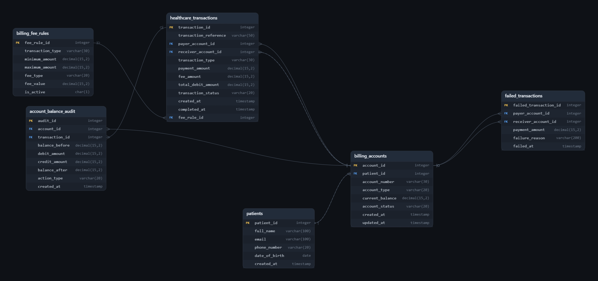

# Healthcare Billing & Transaction Management System

## Overview

This project implements a SQL-based Healthcare Billing and Transaction Management System designed to manage healthcare-related billing accounts and financial transactions.

The system is designed to demonstrate how SQL can be used to manage **transaction processing, account balances, fee calculation, transaction validation, audit trails, and financial consistency** within a healthcare environment.

The project focuses on:

* Patient billing accounts
* Healthcare payment transactions
* Transaction fee rules
* Account balance management
* Transaction validation
* Successful and failed transactions
* Account balance auditing
* ACID transaction principles
* Healthcare billing analytics

All data used in this project is simulated for educational purposes.

---

## Project Objectives

The main objectives of this project are to:

* Build a healthcare-focused billing database.
* Design relational tables for healthcare transactions.
* Manage patient billing accounts.
* Process healthcare payment transactions.
* Implement configurable transaction fee rules.
* Maintain account balance integrity.
* Track successful and failed transactions.
* Maintain an account balance audit trail.
* Apply database constraints for data integrity.
* Demonstrate ACID transaction principles.
* Use transaction control with `START TRANSACTION`, `COMMIT`, and `ROLLBACK`.
* Apply SQL analytical techniques to healthcare billing data.
* Analyze transaction activity and financial performance.

---

## Database Architecture

The system follows a **relational database architecture**.

### Main Tables

* `patients`
* `billing_accounts`
* `billing_fee_rules`
* `healthcare_transactions`
* `account_balance_audit`
* `failed_transactions`

---

## Schema

The Entity Relationship Diagram represents the relationships between patients, billing accounts, healthcare transactions, fee rules, and audit records.



---

## Database Structure

### patients

The `patients` table stores basic patient information.

It contains:

* Patient ID
* Full Name
* Email
* Phone Number
* Date of Birth
* Account Creation Date

---

### billing_accounts

The `billing_accounts` table stores healthcare billing accounts.

It contains:

* Account ID
* Patient
* Account Number
* Account Type
* Current Balance
* Account Status
* Creation Date
* Last Update Date

Account types include:

* Patient
* Insurance
* Hospital

---

### billing_fee_rules

The `billing_fee_rules` table stores the rules used to calculate transaction fees.

It supports:

* Transaction Type
* Minimum Transaction Amount
* Maximum Transaction Amount
* Fixed Fees
* Percentage Fees
* Active and Inactive Rules

---

### healthcare_transactions

The `healthcare_transactions` table stores healthcare payment transactions.

It contains:

* Transaction ID
* Transaction Reference
* Payer Account
* Receiver Account
* Transaction Type
* Payment Amount
* Fee Amount
* Total Debit Amount
* Transaction Status
* Creation Date
* Completion Date

Transaction types include:

* Consultation
* Laboratory
* Radiology
* Medication
* Insurance

---

### account_balance_audit

The `account_balance_audit` table maintains a history of billing account balance changes.

It records:

* Account
* Related Transaction
* Balance Before
* Debit Amount
* Credit Amount
* Balance After
* Action Type
* Timestamp

This table provides an audit trail for account balance modifications.

---

### failed_transactions

The `failed_transactions` table stores healthcare payment transactions that could not be completed.

It records:

* Payer Account
* Receiver Account
* Payment Amount
* Failure Reason
* Failure Timestamp

Examples of failure reasons include:

* Insufficient Balance
* Invalid Account
* Inactive Account
* Same Payer and Receiver
* Invalid Transaction Amount

---

## Transaction Processing

A healthcare payment transaction follows a controlled processing workflow.

```text
Validate Accounts
       ↓
Find Fee Rule
       ↓
Calculate Fee
       ↓
Validate Account Balance
       ↓
Create Transaction
       ↓
Debit Payer Account
       ↓
Credit Receiver Account
       ↓
Create Audit Records
       ↓
     COMMIT
```

If any validation fails:

```text
Validation Failure
       ↓
    ROLLBACK
       ↓
Record Failed Transaction
```

This approach ensures that a failed transaction does not leave partial balance changes in the database.

---

## ACID Transaction Principles

The project demonstrates the four fundamental ACID properties.

### Atomicity

A healthcare payment consists of multiple database operations.

For example:

* Create transaction record.
* Debit payer account.
* Credit receiver account.
* Create audit records.

These operations should be completed together.

If one operation fails, the transaction can be rolled back.

---

### Consistency

Database constraints and validation rules help maintain consistent data.

Examples include:

* Account balances cannot be negative.
* Payment amounts must be positive.
* Payer and receiver accounts cannot be the same.
* Transaction references must be unique.
* Account statuses must contain valid values.

---

### Isolation

Transactions should operate independently when multiple billing operations are processed at the same time.

The project demonstrates transaction boundaries and discusses the importance of appropriate isolation and locking strategies when implementing the system in a production database environment.

---

### Durability

After a successful `COMMIT`, completed transaction changes are intended to remain permanently stored in the database.

---

## Healthcare Billing Flow

A simplified healthcare billing scenario can be represented as:

```text
Patient
   ↓
Healthcare Service
   ↓
Billing Account
   ↓
Payment Transaction
   ↓
Fee Calculation
   ↓
Balance Validation
   ↓
Account Balance Update
   ↓
Audit Trail
   ↓
Billing Analysis
```

For example, a patient may use a billing account to pay for:

* Medical consultation.
* Laboratory services.
* Radiology services.
* Medication.
* Insurance-related payments.

---

## Transaction Validation

Before completing a healthcare payment, the system validates important conditions.

Examples include:

* Payer account exists.
* Receiver account exists.
* Both accounts are active.
* Payer and receiver are different.
* Payment amount is greater than zero.
* Payer has sufficient balance.
* A valid fee rule exists.

If validation succeeds, the transaction can proceed.

If validation fails, the transaction is rejected and recorded in the failed transaction history.

---

## Transaction Audit Trail

The system maintains an audit trail for account balance changes.

For example:

```text
Balance Before
      ↓
Debit / Credit
      ↓
Balance After
```

This allows the system to track how each transaction affected an account balance.

The audit trail can be used for:

* Financial verification.
* Transaction investigation.
* Account history.
* Error detection.
* Billing reconciliation.

---

## Healthcare Billing Analytics

The database supports analytical questions such as:

### Patient Billing Analytics

* How much has each patient paid?
* Which patients have the highest billing activity?
* How many transactions are associated with each patient?
* What is the average payment per patient?

### Account Analytics

* Which accounts have the highest balances?
* Which accounts have low balances?
* How does account activity change over time?
* Which account types have the highest transaction volume?

### Transaction Analytics

* How many healthcare transactions are completed?
* Which transaction types are most common?
* What is the total transaction value?
* What is the average transaction amount?
* What is the total transaction fee?

### Failed Transaction Analytics

* How many transactions failed?
* What are the most common failure reasons?
* Which accounts have the highest number of failed transactions?
* What percentage of transactions were unsuccessful?

### Financial Analytics

* What is the total healthcare payment volume?
* What is the total fee revenue?
* What is the average transaction value?
* Which transaction types generate the highest payment volume?

---

## SQL Concepts Demonstrated

This project demonstrates several important SQL and database concepts:

* Relational Database Design
* Database Schema Design
* Primary Keys
* Foreign Keys
* UNIQUE Constraints
* CHECK Constraints
* NOT NULL Constraints
* Indexing
* JOINs
* GROUP BY
* Aggregate Functions
* `COUNT()`
* `COUNT(DISTINCT ...)`
* `SUM()`
* `AVG()`
* `MIN()`
* `MAX()`
* `ROUND()`
* CASE Statements
* DISTINCT
* Subqueries
* Analytical Queries
* Transaction Management
* `START TRANSACTION`
* `COMMIT`
* `ROLLBACK`
* ACID Principles
* Data Validation
* Audit Trails
* Healthcare Billing Analytics

---

## Example Analytical Questions

The SQL project answers questions such as:

```text
1. Which patients have the highest total billing activity?

2. Which billing accounts have the highest balances?

3. What is the total healthcare payment volume?

4. Which healthcare transaction type is the most common?

5. What is the average payment amount for each transaction type?

6. What is the total transaction fee generated?

7. Which accounts have the highest number of transactions?

8. What are the most common reasons for failed transactions?

9. How many successful and failed transactions exist?

10. Which patients have the highest total healthcare payments?

11. What is the average transaction amount?

12. Are account balances consistent with recorded transactions and audit records?
```

---

## Data Integrity

The database uses several constraints to help maintain reliable healthcare billing data.

Examples include:

* Primary Key constraints.
* Foreign Key relationships.
* Unique transaction references.
* Positive payment amount validation.
* Non-negative account balances.
* Valid account statuses.
* Valid transaction statuses.
* Valid transaction types.
* Payer and receiver account validation.

These constraints help prevent invalid billing records from entering the database.

---

## Data Privacy

All healthcare and billing information in this project is **simulated**.

No real patient data, medical records, financial information, or Protected Health Information (PHI) is included.

Patient names, accounts, transactions, and billing information are fictional examples created for database design and SQL practice.

This project is intended for educational and portfolio purposes and is **not designed for production financial processing or clinical decision-making**.

---

## Future Improvements

Possible future extensions include:

* Add healthcare providers.
* Add hospitals and departments.
* Add invoices and invoice items.
* Add insurance companies.
* Add insurance claims.
* Add payment methods.
* Add refunds and reversals.
* Add patient billing statements.
* Add monthly billing reports.
* Add revenue analysis.
* Add payment dashboards.
* Add financial reconciliation reports.
* Build ETL pipelines using Python.
* Connect the database to Power BI.
* Connect the database to Tableau.
* Build an interactive healthcare billing dashboard.
* Implement authentication and authorization.
* Add role-based access control.
* Implement DBMS-specific stored procedures and triggers.
* Implement production-level concurrency and locking strategies.

---

## Technologies

* SQL
* Standard SQL
* Relational Database
* Transaction Management
* ACID Principles
* Analytical SQL
* Database Design
* Healthcare IT
* Healthcare Billing Analytics

---

---

## Author

**Abdelrahman Osman**

Health Informatics Student | Data Analytics Enthusiast

Interested in:

* Health Informatics
* Healthcare Analytics
* SQL
* Data Analytics
* Healthcare IT
* Database Design
* Healthcare Data Management
